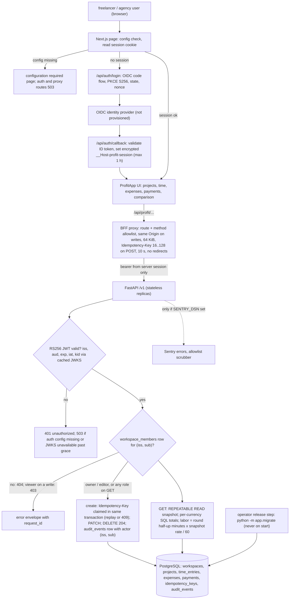
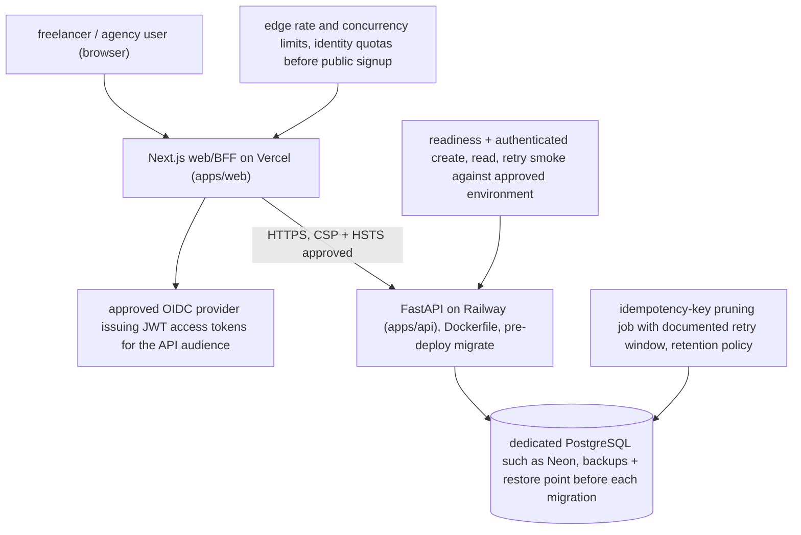

# 01 — Business process (As-Is / To-Be)

Project Profit Tracker คือ SaaS แบบ standalone ให้ freelancer และ agency เล็กบันทึกโปรเจกต์ เวลาทำงาน ค่าใช้จ่าย และเงินที่ได้รับจริง แล้วดูกำไรจริงเทียบกำไรคาดการณ์ แยกตามสกุลเงิน ประกอบด้วย Next.js web/BFF (`apps/web`) และ FastAPI + PostgreSQL (`apps/api`) ซึ่งตาม README ยังไม่ได้ provision หรือ deploy

Last reviewed: 2026-11-27 · commit `ca4778d`

## As-Is (จากโค้ดวันนี้)

Sources: `apps/web/app/page.tsx`, `apps/web/app/api/auth/*/route.ts`, `apps/web/app/api/profit/[...path]/route.ts`, `apps/web/lib/proxy.ts` (`ROUTES`, `IDEMPOTENCY_KEY`), `apps/web/lib/session.ts`, `apps/api/app/main.py` (`/health`, `/ready`), `apps/api/app/auth.py`, `apps/api/app/service.py` (`require_role`, `record_audit`), `apps/api/app/routes.py`, `apps/api/app/models.py`, `apps/api/app/migrate.py`, `apps/api/app/observability.py`, `.github/workflows/ci.yml`, `README.md`, `apps/api/README.md`, `apps/web/README.md`

ข้อเท็จจริงจากโค้ด:

- ผู้สร้าง workspace เป็น `owner` อัตโนมัติ; ยังไม่มี endpoint เชิญหรือจัดการสมาชิก (เพิ่มสมาชิกได้ด้วยการเขียน DB เท่านั้น)
- API รับ `Idempotency-Key` 1–128 ตัว `[A-Za-z0-9._:-]` แต่ BFF บังคับ 16–128 ตัว `[A-Za-z0-9._-]` (ไม่รับ `:`)
- ไม่มี job ลบแถว `idempotency_keys` อัตโนมัติ; web BFF ไม่มี Sentry; ไม่มี CSP / HSTS ระดับแอป
- CI (push `main`, PR) รัน shared `ci-python` (apps/api), `ci-node` (apps/web, `npm run build`) และ security scan; ไม่มี deploy job
- ไม่มี Railway service, Vercel project หรือฐานข้อมูลที่ provision แล้วตาม README **[ต้องยืนยัน]** (ตรวจจาก repo เท่านั้น ไม่ได้ตรวจ provider)

## To-Be (docs/architecture.md §Release gates, README.md §Deployment boundary)

Sources: `docs/architecture.md` §Release gates (1–8), §What scaling means here; `README.md` §Deployment boundary; `apps/api/README.md` §Deployment

## Gap

| ID | As-Is → To-Be | Status | Owner | Evidence |
|---|---|---|---|---|
| G1 | ยังไม่ provision หรือ deploy อะไร → owner อนุมัติ provisioning และ environment เป้าหมาย (Vercel, Railway, PostgreSQL เฉพาะ) | decide | owner | `docs/architecture.md` §Release gates 4; `README.md` §Deployment boundary |
| G2 | ไม่มี identity provider → IdP ออก JWT access token ตาม audience ของ API และ smoke test login + workspace isolation | blocked | owner | release gate 5; `apps/web/README.md` §Identity provider setup (PENDING); รอ G1 |
| G3 | ไม่มีฐานข้อมูล production → migrate แล้ว, ตั้ง backup / recovery, ตรวจ role และ TLS | blocked | claude | release gate 6; `apps/api/README.md` §Rollback and backup; รอ G1 |
| G4 | ยังไม่เคย build Docker image หรือ smoke test บน environment จริง → readiness + authenticated create / read / retry ผ่าน | todo | claude | release gate 7; `apps/api/README.md` §Deployment (image not built) |
| G5 | ไม่มี rate / concurrency limit ที่ edge และ identity quota → ตั้งก่อนเปิด public signup | todo | claude | release gate 8 |
| G6 | ไม่มี job ลบ `idempotency_keys` และไม่มี retention ของ financial / audit records → job + นโยบาย retention พร้อม retry window | todo | claude | release gate 8; `apps/api/README.md` §API notes |
| G7 | ไม่มี CSP / HSTS ระดับแอป → HTTPS enforcement ที่ host และ CSP แบบ nonce ที่ owner อนุมัติ | todo | claude | `docs/architecture.md` (หลัง §Release gates) |
| G8 | ยังไม่วัด load, p95, availability หรือ connection budget → load test และ connection budget ตาม provider ก่อน commercial launch | todo | claude | `docs/architecture.md` §What scaling means here |
| G9 | ไม่มีการเชิญ / จัดการสมาชิก workspace (นอก MVP ตาม `PRODUCT.md`) → owner ตัดสินว่าจะเป็นเป้าหมายรอบถัดไปหรือไม่ | decide | owner | `README.md` §MVP boundary; `apps/api/README.md` §OIDC setup (known gap) |

## Open questions

- BFF บังคับ `Idempotency-Key` อย่างน้อย 16 ตัวและไม่รับ `:` ขณะที่ API รับ 1–128 ตัวรวม `:`: ตั้งใจให้ต่างกันหรือไม่
- web BFF ยังไม่มี Sentry (`PRODUCT.md` §Evidence on Hand): ต้องการเพิ่มก่อน launch หรือไม่ (ไม่มีเป้าหมายที่เขียนไว้)
